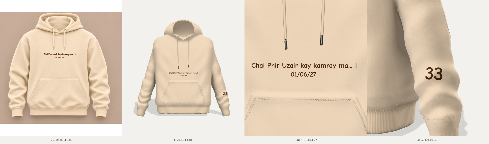
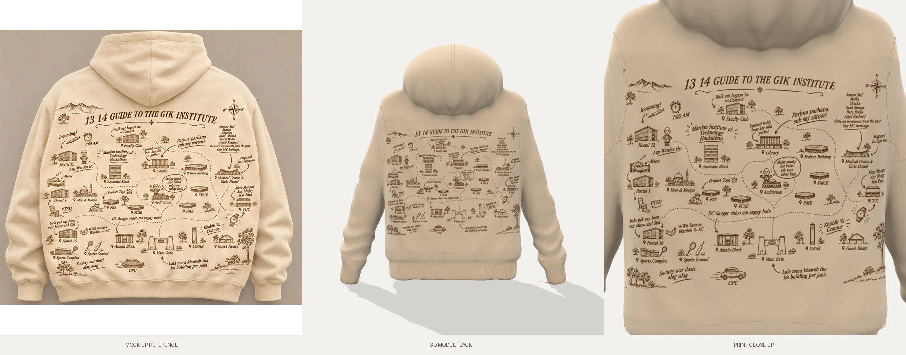

# Realistic Cream-Beige Hoodie (3D) — GIK prints

**Live 3D viewer:** https://claude.ai/artifact/3hkLLwRwZE3gaSFJWwWvRm





## Front print

Two centred lines in dark chocolate-brown ink (`#43220A`), set in Comic Neue Bold
(`artwork/fonts/`, SIL Open Font License), just below the draw-cord tips:

> Chai Phir Uzair kay kamray ma... !
> 01/06/27

The first line is 30 cm wide. It is the `Front_Print` object (material `Front_Print_Ink`).
To change the wording, size or position, edit `FRONT_LINES`, `FRONT_TEXT_W` and
`FRONT_TEXT_CY` in `build_hoodie.py` and rebuild.


## Sleeve print

A small **33** (3.4 cm tall digits, same font and ink as the front) on the outer forearm of the
right sleeve, the one on the right in the front view (x > 0). It is the `Sleeve_Print` object.
`SLEEVE_SIDE = -1` in `build_hoodie.py` moves it to the other sleeve; `SLEEVE_TEXT` and
`SLEEVE_TEXT_H` change the text and size.

## Back print

The back carries the **"13 14 Guide to the GIK Institute"** map (`artwork/gik_map_artwork.webp`),
placed like the mock-up (`artwork/back_print_mockup_reference.webp`): centred under the hood,
58 cm wide, running down to just above the rib hem.

- The parchment background is removed, so only the sepia-brown ink (`#4E2E14`) is printed and
  the fleece shows through, like a real screen print (`artwork/gik_map_back_print.png`).
- It is its own object, `Back_Print`, a thin decal that follows the folds of the back panel
  (0.8 mm above it). Its material, `Back_Print_Ink`, keeps the fleece knit texture. To swap
  the artwork, replace the PNG (or `PRINT_SRC` in `build_hoodie.py`) and rebuild.

A rebuilt, more realistic version of the *Oatmeal Taupe Hoodie 3D Editable Kit* (the original is kept in `original_kit/`).
The proportions and colour were matched to the reference product photo.

## Files

| Path | What |
|---|---|
| `model/oatmeal_hoodie_realistic.glb` | **Main model** (glTF 2.0, PBR + fleece sheen, textures embedded) |
| `model/oatmeal_hoodie_realistic_obj.zip` | OBJ + MTL + textures, for tools without glTF |
| `model/textures/` | Tiling jersey-fleece / rib-knit normal maps and grain colour maps |
| `viewer/index.html` | three.js studio viewer (finds `../model/*.glb` automatically; serve over http) |
| `renders/` | Front, 3/4, side, back and pocket close-up renders |
| `build_hoodie.py` | Generator: run it to rebuild everything |
| `tools/render.js` | Headless render script (Playwright) |

## What changed vs. the original kit

| Original | Realistic version |
|---|---|
| Separate tubes intersecting, puffy "balloon" sleeves | One continuous fabric shell (SDF + marching cubes), natural armpit blend |
| Helmet-like round hood | Upright hood with a rolled front edge, V crossover at the neck and a centre-back seam |
| Short, boxy body | Oversized drop-shoulder fit, proportions measured off the photo |
| No folds | Drape folds, elbow creases, stacked folds above the cuffs, blousing over the rib hem |
| Flat colours | Jersey-fleece and 1x1 rib normal maps, fabric grain, `KHR_materials_sheen` brushed-fleece sheen, baked ambient occlusion and heather mottle |
| Solid stitch tubes | Dashed tonal topstitching on the pocket, hem, cuffs, armholes, shoulders, side seams and hood |
| Thin cords | Draw-cords that hang over the chest, with gunmetal aglets and eyelets |

**Colour:** creamy beige, fabric albedo `#F2DCC0` (rib `#ECD5B8`). Under the studio lighting it renders at RGB ≈ 234/211/184, against ≈ 239/215/184 for the fabric in the print mock-ups.

## Editing in Blender

`File → Import → glTF 2.0` and pick `oatmeal_hoodie_realistic.glb`. The pieces are separate objects:
`Front_Body`, `Back_Body`, `Kangaroo_Pocket`, `Sleeve_Left/Right`, `Hood`, `Rib_Hem`,
`Rib_Cuff_Left/Right`, `Topstitching`, `Drawcords`, `Drawcord_Eyelets`, `Aglets`.

- **Recolour:** change *Base Color* on `Fleece_Oatmeal` / `Rib_Knit_Oatmeal`, or edit `FABRIC_HEX` in `build_hoodie.py`.
- **Baked shading:** ambient occlusion lives in the `Color` attribute (COLOR_0), which multiplies the base colour.
- **UVs:** tiled at 1 UV unit = 5 cm, so the fabric texture repeats. For a print or logo, add a decal or a second UV map on `Front_Body` / `Back_Body`.
- **Units:** metres. Y is up and +Z is the front.

## Rebuild

```bash
pip install numpy scipy scikit-image trimesh fast-simplification pygltflib pillow
```

```bash
python build_hoodie.py
```

`QUICK=1 python build_hoodie.py` does a fast low-resolution preview build.
The model is about 357k triangles. It is a static garment, not rigged or set up for cloth simulation.
